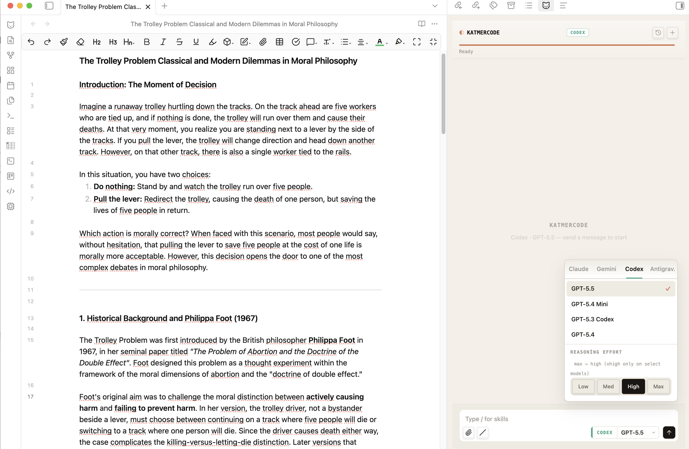

# KatmerCode

Multi-provider AI chat inside Obsidian — Claude, Gemini, Codex, and Antigravity in one sidebar, with per-tab routing, inline diff editing, academic research skills, and MCP support.

[](https://obsidian.md)
[](LICENSE)
[]()

An Obsidian plugin that puts four AI assistants in your sidebar — each chat tab can run a different provider. Built for researchers who write in Obsidian and want to compare model takes, edit manuscripts, check citations, and run peer-review workflows without leaving the editor.

Ships with **7 academic research skills** that work as slash commands across every provider. **Desktop only** (requires the corresponding provider CLIs).



---

## Providers

| Provider | Auth | Notes |
|---|---|---|
| **Claude Code** | Anthropic Pro/Max subscription via `claude` login | Original integration. Full feature set: streaming, tools, inline diff, thinking blocks, MCP. |
| **Gemini** | Google login via `gemini` (works with AI Pro / One subscriptions) | Streams text, tool calls, inline diff (`replace` tool aliased to Edit). |
| **Codex** | ChatGPT Plus/Pro subscription via `codex login` | Reasoning effort wired (`model_reasoning_effort`), MCP, web search. |
| **Antigravity** | Same Google login as Gemini (via `agy` browser auth) | Chat only — `agy` v1.0.2 doesn't yet expose structured output. Provided as a migration path before Gemini CLI's June 18 2026 sunset for Google AI Pro accounts. |

Each chat tab pins its own provider + model — Codex in one tab while Gemini works on something else in another. Hit **Consult another model** on any reply to get a second opinion inline (the consulted model's response and the active model's synthesis appear in the same conversation, no tab switching).

---

## Quick Start

1. Install at least one provider CLI. Order of friction (lowest first):
   - `npm install -g @anthropic-ai/claude-code && claude`
   - `npm install -g @google/gemini-cli && gemini`
   - `npm install -g @openai/codex && codex login`
   - `curl -fsSL https://antigravity.google/cli/install.sh | bash && agy`
2. Clone and build: `git clone https://github.com/hkcanan/katmer-code.git && cd katmer-code && npm install && npm run build`
3. Copy `main.js`, `manifest.json`, `styles.css` into `<your-vault>/.obsidian/plugins/katmer-code/`
4. Enable **KatmerCode** in Obsidian → Settings → Community Plugins
5. (Optional) Settings → KatmerCode → toggle **Auto-mirror CLAUDE.md to other providers** so your custom rules apply everywhere
6. For academic skills: toggle them on + enable **Allow Web Requests**

---

## What It Does

- **Routes per tab to any provider** — Claude SDK + Gemini/Codex/Antigravity CLIs behind one ProviderAdapter interface. Each tab keeps its own conversation, provider, and model independently.
- **Inline diff editing** — word-level track changes in the editor (accept/undo) for Claude and Gemini; Codex applies edits directly (its CLI doesn't expose old/new text for inline rendering).
- **Same-tab consult** — Each reply gets a small **Consult** button that spawns the target provider in the background, renders its take as a consultation card, then has the active model synthesize the two views — all without leaving the conversation. Pick the specific model to consult right from the menu.
- **Mid-conversation switch markers** — When you flip provider or model mid-thread, a horizontal divider documents what changed. Provider switches also warn that previous context isn't carried across CLIs.
- **In-plugin login** — If a provider isn't authenticated, click the picker chip and the plugin runs the CLI's login flow itself (Claude / Codex) or opens Terminal with the right command (Gemini / Antigravity). Polls every few seconds until auth status flips.
- **HTML research reports** — peer review, citation analysis, gap analysis, journal match — viewable inside Obsidian.
- **Skills on every provider** — slash commands like `/peer-review` run natively on Claude (via `~/.claude/commands/`) and via prompt-injection on Gemini/Codex/Antigravity. Same markdown, same output, four backends.
- **Shared instructions** — auto-mirror `CLAUDE.md` to `GEMINI.md` and `AGENTS.md` (global and vault scope) so the same rules reach every model. Files watched, re-synced on edit.
- **Reasoning effort** — wired for Claude (SDK `effort`) and Codex (`model_reasoning_effort`). Gemini's `thinking_level` is API-only until the CLI exposes it; effort UI auto-hides where unsupported.
- **Per-model context tracking** — Context strip shows real input tokens against the model's actual window (1M for Gemini 2.5 / 3.x family, 400K for Codex GPT-5.x, 200K-1M for Claude). Catalog-driven, not a generic 200K fallback.
- **MCP servers** — each provider reads its own MCP config (`~/.claude.json`, `~/.gemini/`, `~/.codex/`) — no extra setup.
- **Bottom-anchored thinking indicator** — While the model is preparing a reply you see a "is thinking…" pill right under your message, so you're never staring at nothing during the latency between send and first token.
- **Copy reply** — small button on every assistant message footer; copies markdown to clipboard with a checkmark confirmation.

---

## Screenshots

### Chat Panel

*Text selection auto-attaches as context. Tool calls, thinking blocks, and streaming text in the sidebar.*

### Inline Diff Editing

*Word-level track changes — red strikethrough for removed text, green underline for additions. Accept (✓) or undo (✕).*

### Peer Review Report

*`/peer-review` generates an HTML report with 8 criteria scores, radar chart, and detailed evaluation.*

### Citation Verification & Missing References

*Claim-level verification with assessment badges. Missing references ranked by citation count and relevance.*

---

## Academic Skills

Enable from **Settings → KatmerCode → Academic Skills**. Each skill installs as a slash command.

> **A note on expectations:** These skills are research aids, not oracles. They query real academic databases (Semantic Scholar, CrossRef, OpenAlex, Unpaywall, arXiv, PubMed) and apply structured analysis — but the outputs are starting points, not final verdicts. A `/peer-review` report won't replace a human reviewer. A `/cite-verify` run may flag a valid reference as unverified if the database lacks coverage. The value is in surfacing things you might miss: a gap in the literature you hadn't considered, a highly-cited paper absent from your references, or a structural weakness in your argument that's easier to see when laid out in a table. Use the reports as a map, not as the territory.

### How the skills work

1. **You provide a manuscript** — either the active file, a file path, or selected text.
2. **Claude reads and analyzes it** — parsing structure, extracting claims, identifying references.
3. **APIs are queried** — the skill calls academic databases to cross-check, search, or enrich.
4. **An HTML report is generated** — with tables, charts, and actionable findings.
5. **The report opens in Obsidian** — or in your browser, your choice.

For longer tasks (peer review with citation verification, research gap analysis), Claude uses **subagents** — parallel workers that handle different parts of the analysis simultaneously.

### Available skills

| Command | What it does | Typical use case |
|---------|-------------|-----------------|
| `/peer-review` | Evaluates your manuscript across 8 criteria (originality, argument structure, literature coverage, methodology, etc.). Produces a radar chart and section-by-section feedback. | Before submitting: "What would a reviewer likely flag?" |
| `/cite-verify` | Checks every reference against CrossRef, Semantic Scholar, and OpenAlex. Flags mismatches in author names, years, or titles. Tests whether cited claims are actually supported by the source. | After drafting: "Are my citations accurate?" |
| `/lit-search` | Searches arXiv, Semantic Scholar, PubMed, and OpenAlex in parallel. Deduplicates results and ranks by relevance. | Starting a new project: "What's been published on X?" |
| `/citation-network` | Builds an interactive citation graph (vis.js) showing who cites whom. Includes a timeline view. | Understanding a field: "How do these papers relate?" |
| `/research-gap` | Identifies temporal, methodological, thematic, and application gaps in the literature. Scores each gap by feasibility and potential impact. | Planning research: "Where are the opportunities?" |
| `/journal-match` | Analyzes your manuscript's reference profile and suggests target journals based on where your cited sources are published. | Ready to submit: "Which journal fits this paper?" |
| `/abstract` | Generates abstracts in 5 formats: structured, narrative, graphical description, highlights, and social media summary. | Finalizing: "Write me a structured abstract." |

### Skill outputs

#### `/cite-verify` — Citation verification

*Each reference is checked against CrossRef, Semantic Scholar, and OpenAlex. Issues flagged with assessment badges — year errors, suspect citations, recommended fixes.*

#### `/journal-match` — Journal recommendations

*Top 10 journals scored on scope, impact, audience, and acceptance. Current journal assessed with strengths/weaknesses.*


*Strategic recommendation with best option, strong alternative, and safe alternative — each with reasoning.*

#### `/research-gap` — Gap analysis

*Gaps ranked by priority and impact. Evidence density shows how underexplored each area is.*


*Each gap includes evidence base, research question, feasibility assessment, and strategic note.*


*Publication trend chart shows field activity over time — useful for identifying emerging or declining areas.*

### Report design

All skills produce HTML reports with a shared design system:
- **Crimson Pro** serif typography (academic book aesthetic)
- **Chart.js** for radar charts, bar charts, timelines
- **Alpine.js** for collapsible sections and interactive elements
- Consistent color palette, table styles, and badge system across all report types

Reports open inside Obsidian (iframe viewer) or in your default browser. A notification appears automatically when a new report is generated.

### A practical example

Say you've drafted a paper on AI in legal reasoning. Here's one way to use the skills:

1. `/peer-review makaleler/demo-article.md` — get a structured evaluation before asking colleagues
2. Review the radar chart — notice "Literature Coverage" scored low
3. `/lit-search AI legal reasoning hermeneutics` — find papers you may have missed
4. `/cite-verify makaleler/demo-article.md` — check that all 14 references are accurate
5. `/journal-match makaleler/demo-article.md` — see which journals publish similar work
6. Edit your manuscript based on the findings, then run `/peer-review` again

No single run gives you a definitive answer. But each one shows you something you might not have seen on your own.

---

## Requirements

- **Obsidian** 1.4.0+ (desktop only — macOS, Windows, or Linux)
- **Claude Code CLI** installed and logged in
- **Claude account** with API access

```bash
npm install -g @anthropic-ai/claude-code
claude  # log in once
```

## Installation

### Build from source

```bash
git clone https://github.com/hkcanan/katmer-code.git
cd katmer-code
npm install
npm run build
```

This produces three files in the project root: `main.js`, `manifest.json`, and `styles.css`.

Copy all three into your vault:

```bash
mkdir -p <your-vault>/.obsidian/plugins/katmer-code
cp main.js manifest.json styles.css <your-vault>/.obsidian/plugins/katmer-code/
```

Then enable **KatmerCode** in Obsidian → Settings → Community Plugins.

---

## Configuration

| Setting | Default | Description |
|---------|---------|-------------|
| Default provider | Claude | Provider new tabs spawn with. Each tab can override via the picker. |
| Per-provider CLI path | auto-detect | Override if the CLI lives somewhere `which` doesn't find it. |
| Working Directory | vault root | Where CLI sessions run. |
| Permission Mode | Accept Edits | Mapped per provider: Claude `acceptEdits`, Codex `--sandbox workspace-write`, Antigravity `--dangerously-skip-permissions`. |
| Allow Web Requests | Off | Needed for academic skills (enables WebFetch / WebSearch / curl on Claude, `web_search="live"` on Codex). |
| Auto-mirror CLAUDE.md | Off | Copy `CLAUDE.md` to `GEMINI.md` and `AGENTS.md` (both global and vault scope) and re-sync on edit. |

### Per-tab provider routing

Each chat tab has its own `ProviderAdapter`. Switching the provider via
the picker below the input affects only that tab; other tabs keep
running their own backend. New tabs inherit the active tab's provider.

### Same-tab consult

Every completed assistant message has a footer with two compact
buttons:

- **Copy** — drops the reply (markdown) into your clipboard with a
  checkmark confirmation.
- **Consult** — opens a menu of the other three providers, each with
  the model that'll be used and a `▾` to pick a different one
  (e.g. "Consult Gemini · 2.5 Pro ▾"). Click and:
  1. Plugin spawns the target provider in the background with the
     active reply as context.
  2. Its response renders as a **consultation card** in the
     conversation (provider-colored rail, italic header).
  3. A compact **synthesis pill** is added (no full user bubble, no
     repeated quote) so the active model synthesizes the consult's
     view against its own.
  4. Active model's synthesis streams in below.

Everything happens in the current tab. No context loss, no tab
switching. The pill has a `view prompt` toggle in case you want to
see exactly what was sent to the active model.

A secondary "↗ Open in a new tab instead" option is at the bottom of
the menu for users who prefer full isolation between models.

### Mid-conversation switch markers

If you swap provider or model mid-thread (via the picker), a
horizontal divider documents the change inline:

```
─── Switched model · Sonnet → Opus 1M ───
```

Provider switches add a warning that prior conversation context
isn't carried across CLIs:

```
─── Switched to Codex · GPT-5.5 → from Gemini · 3.1 Pro Preview ───
        ⚠ Previous conversation context isn't carried over
```

### Login from the plugin

If a provider's CLI is installed but you're not authenticated, the
provider chip in the picker shows an amber **login** badge.
Clicking it:

- **Claude / Codex** — Plugin runs `claude auth login` / `codex
  login` itself. Browser opens, you finish the OAuth flow, plugin
  polls `auth status` every 3s and flips the chip to ✓ as soon as
  it succeeds. Click the in-progress toast at any time to manually
  recheck.
- **Gemini / Antigravity** — These CLIs are interactive TUIs with no
  headless login subcommand, so the plugin opens Terminal.app with
  the right command. Complete login there, come back, picker
  re-detects.

### Reasoning effort

The effort selector (low / med / high / max) appears for providers
that honour it:
- **Claude** — SDK `effort` option.
- **Codex** — `--config model_reasoning_effort` (plugin maps "max" to
  "high" for compatibility; "xhigh" is only available on
  gpt-5.1-codex-max and similar variants).
- **Gemini / Antigravity** — hidden. Gemini 3.x has `thinking_level`
  in the API but the CLI hasn't exposed a flag yet
  ([gemini-cli#25122](https://github.com/google-gemini/gemini-cli/issues/25122)).

### MCP Servers (optional)

Each provider reads its own MCP config — no extra plumbing in the
plugin:
- **Claude** — `~/.claude.json`
- **Gemini / Antigravity** — `~/.gemini/settings.json` and `~/.gemini/` configs
- **Codex** — `~/.codex/config.toml`

These are **not required** but can speed up academic skills if installed:

- [paper-search-mcp](https://github.com/openags/paper-search-mcp) — 20+ academic databases in one server
- [arxiv-mcp-server](https://github.com/blazickjp/arxiv-mcp-server) — arXiv with full-text PDF reading
- [openalex-research-mcp](https://github.com/oksure/openalex-research-mcp) — Citation analysis, trends, journal quality

Without MCP servers, skills use WebFetch to call APIs directly. This works fine — MCP servers just make it faster and use fewer tokens.

---

## How It Works

```
Obsidian
├── Editor (with inline diffs — CodeMirror state field)
├── KatmerCode Chat (sidebar)
│   ├── Tab 1 ── ProcessManager → ClaudeAdapter   → @anthropic-ai/claude-agent-sdk
│   ├── Tab 2 ── ProcessManager → GeminiAdapter   → gemini -p --output-format stream-json
│   ├── Tab 3 ── ProcessManager → CodexAdapter    → codex exec --json
│   └── Tab 4 ── ProcessManager → AntigravityAdapter → agy --print
│
│   Each adapter normalizes its native event stream into UnifiedEvent
│   (Claude stream-json shape) so the chat-view stays provider-agnostic.
│
│   Shared services:
│   ├── Skills (~/.claude/commands/ for Claude, prompt-injection elsewhere)
│   ├── CLAUDE.md mirror (global + vault → GEMINI.md + AGENTS.md)
│   ├── MCP servers (each provider's own config)
│   └── Inline diff bridge (Edit tool events → CodeMirror state effects)
└── Report Viewer (iframe)
```

Skills are `.md` prompt files installed to `~/.claude/commands/` when
you enable them in settings. They work in Claude directly (the CLI
discovers them via `supportedCommands()`) and in other providers via
prompt injection — the plugin reads the skill markdown and prepends it
to your message as system context.

---

## License

[MIT](LICENSE)

## Contributing

Issues and PRs welcome. This is a side project — built by a researcher, for researchers.
